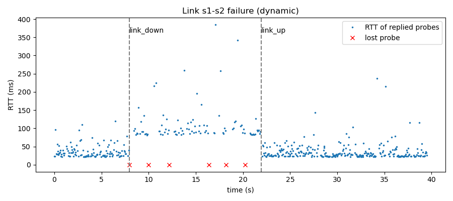
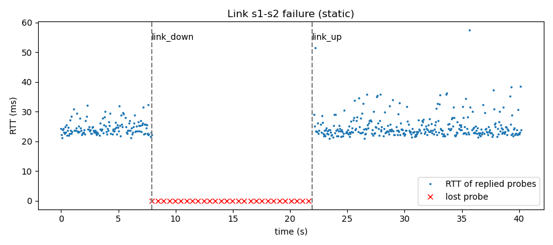
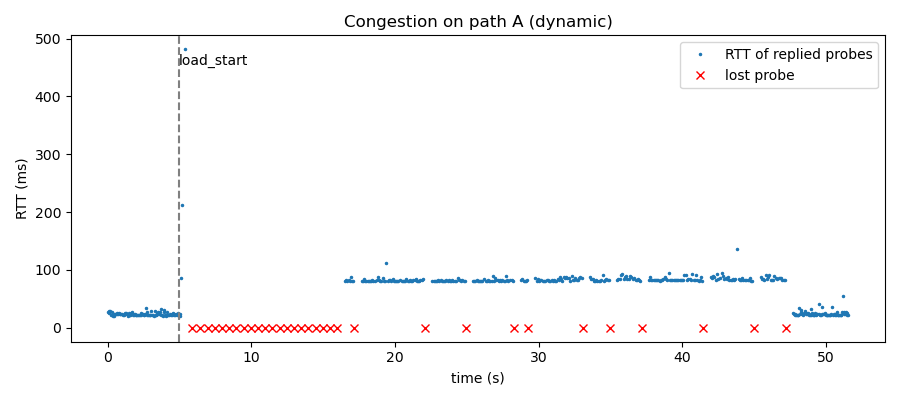
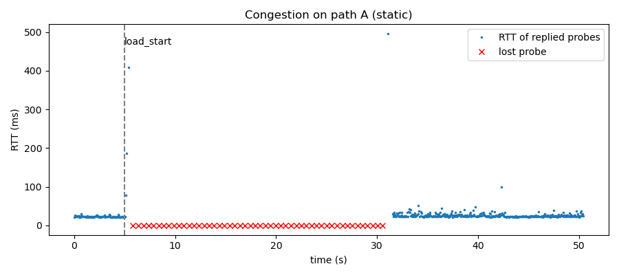

# Network Diagnostic and Path Analysis Tool

SDN + socket programming mini project (UE25CS243A, Computer Networks).
Team: [names and SRNs]

## 1. Problem statement
A socket-based diagnostic application that measures delay, packet loss and path
characteristics in an SDN network, and correlates the results with the SDN topology.

## 2. Architecture
[Insert a diagram: h1 (probe client) -> s1 -> (s2 | s3) -> s4 -> h2 (probe server);
Ryu controller connected to all switches over OpenFlow; analyzer talking to the
controller over REST.]

| Component | File | Role |
|---|---|---|
| Probe server | diag/probe_server.py | UDP echo server on h2 |
| Probe client | diag/probe_client.py | Sends numbered, timestamped UDP probes; computes RTT, jitter, loss |
| SDN controller | controller/diag_controller.py | Topology discovery, path computation, flow rules, failure handling, REST API |
| Orchestrator | diag/analyzer.py | Runs experiments, tags probe results with the active path, reports to controller |
| Topology | topology/diamond_topo.py | 4 switches with 2 alternative paths (A: fast, B: slow and lossy) |

Message flow: probes go h1 -> h2 over UDP; the analyzer asks the controller which path
is active (GET /path), tags the result with it and sends it back (POST /report); the
controller marks degraded paths and reroutes.

## 3. Requirements and where they are implemented
| Requirement | Implementation |
|---|---|
| UDP diagnostic probes | probe_client.py / probe_server.py |
| Measure round-trip time | Timestamp inside each probe; min/avg/max/jitter |
| Detect packet loss | Sequence numbers and a 0.5 s timeout; loss % and longest burst |
| Discover SDN topology | LLDP via Ryu; GET /topology |
| Implement path analysis | All simple paths between host switches; GET /path; flow-table verification |
| Correlate with network paths | Each probe window tagged with the active path; POST /report |
| Identify failed paths | Link event (control plane) and probe loss burst (data plane) |
| Compare alternative paths | POST /reroute pins a path; compare experiment |

## 4. Setup
```bash
sudo apt update && sudo apt install mininet openvswitch-switch python3-venv curl iperf3 -y
python3 -m venv ~/ryuenv && source ~/ryuenv/bin/activate
pip install setuptools==67.6.1 eventlet==0.30.2 ryu networkx
```

## 5. How to run
Terminal 1 (controller):
```bash
source ~/ryuenv/bin/activate
ryu-manager --observe-links controller/diag_controller.py
```
Terminal 2 (one experiment; reset first with `sudo mn -c` and restart the controller):
```bash
sudo python3 diag/analyzer.py correlate
sudo python3 diag/analyzer.py failure [--static]
sudo python3 diag/analyzer.py compare
sudo python3 diag/analyzer.py congestion [--static]
```
All repeats and the summary table: `sudo ./run_repeats.sh 3`

REST API: /topology, /path?src=&dst=, /report, /events, /stats, /reroute, /mode

## 6. Test cases
| # | Test | Expected | Result |
|---|---|---|---|
| 1 | UDP echo, 20 probes | 0 lost | 20/20 received |
| 2 | RTT with 10 ms links | about 40 ms | min 41.34 ms |
| 3 | 10% link loss | about 34% | 36% |
| 4 | Topology discovery | 4 switches, 4 links | [pass] |
| 5 | Path analysis | 2 paths, active s1-s2-s4 | [pass] |
| 6 | Flow tables | rules on s1, s2; none on s3 | [pass] |
| 7 | Correlation | counters only on s1, s2, s4 | 16 / 16 / 0 / 16 |
| 8 | Link failure, dynamic | fast reroute | 19 ms reroute, 0.5 s outage |
| 9 | Link failure, static | no reroute | 14.15 s outage |
| 10 | Path comparison | A faster idle, B better loaded | see section 7 |
| 11 | Congestion, dynamic | reroute away from A | [your result] |
| 12 | Congestion, static | stays on A | [your result] |

[Add screenshots of each.]

## 7. Results
[Paste results/summary.md here, then the graphs:]





Path comparison (results/compare.csv):
| Condition | Path | Avg RTT | Max RTT | Jitter | Loss % |
|---|---|---|---|---|---|
| idle | s1-s2-s4 | 25.35 | 41.23 | 3.09 | 0.0 |
| idle | s1-s3-s4 | 85.72 | 111.22 | 3.37 | 4.58 |
| loaded | s1-s2-s4 | 28.71 | 460.49 | 8.5 | 30.42 |
| loaded | s1-s3-s4 | 87.22 | 227.68 | 5.51 | 2.5 |

## 8. Discussion
- Dynamic rerouting cut the outage from 14.15 s to 0.5 s; the controller itself rerouted in 19 ms.
  The remaining 0.5 s is the probe timeout.
- No path is always best: A is faster when idle but loses 30% under load; B is slower but steadier.
- Under congestion, rerouting traded latency for lower loss.

## 9. Limitations
- Rerouting can oscillate between paths under sustained load (no hysteresis).
- One host pair is probed; paths are chosen per host pair.
- Emulation overhead adds about 5 to 6 ms to measured RTT, and VM timing adds noise.
- Reroute decisions for application reports are made per window (about 1 s granularity).
